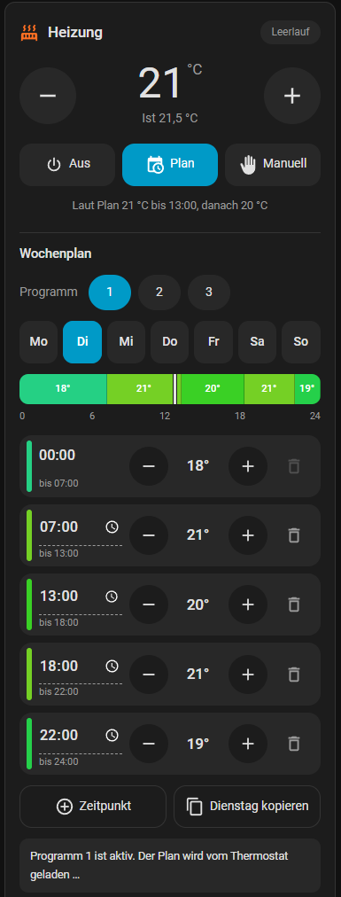
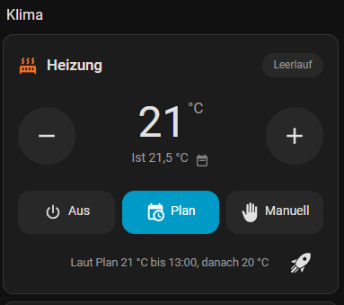
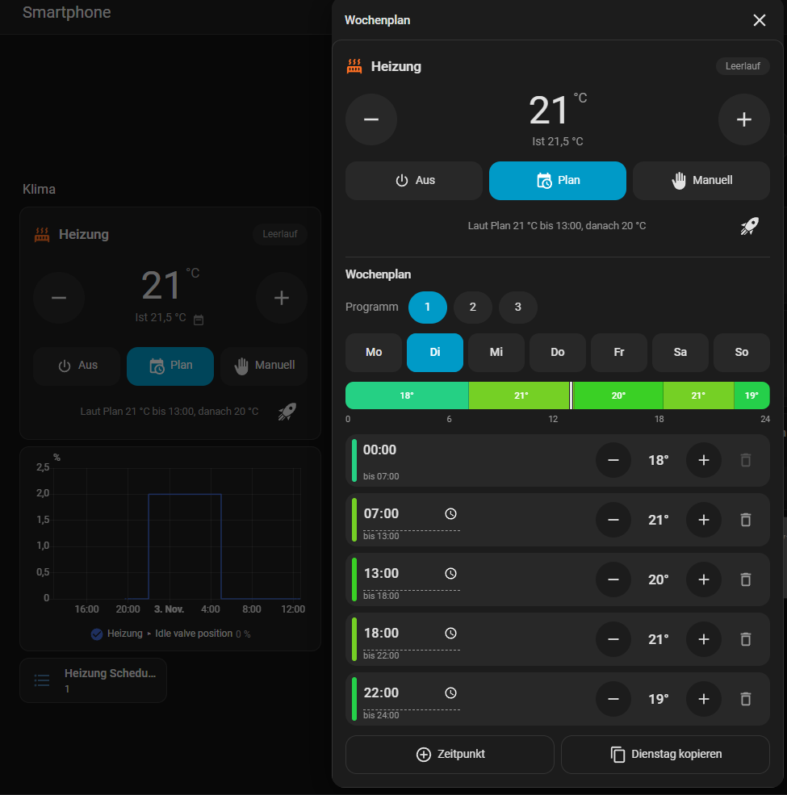

# Smart Heating Planer

[🇬🇧 English](README.md) · [🇩🇪 Deutsch](README.de.md) · 🇨🇿 Čeština · [🇸🇰 Slovenčina](README.sk.md) · [🇵🇱 Polski](README.pl.md) · [🇫🇷 Français](README.fr.md)

Integrace pro Home Assistant s kartou termostatu, v níž můžete týdenní plán radiátorové hlavice upravovat přímo klepnutím. Pro plán není potřeba žádný scheduler ani automatizace: plán je uložen přímo v termostatu a běží dál, i když je Home Assistant nedostupný.

<p align="center">
  
</p>

## Jazyky

Karta se řídí jazykem nastaveným v profilu Home Assistantu (`hass.language`). Výchozí a záložní jazyk je angličtina.

| Jazyk | Soubor |
|---|---|
| English (výchozí) | `translations/card/en.json` |
| Deutsch | `translations/card/de.json` |
| Čeština | `translations/card/cs.json` |
| Slovenčina | `translations/card/sk.json` |
| Polski | `translations/card/pl.json` |
| Français | `translations/card/fr.json` |

Texty konfiguračního dialogu jsou v `translations/<jazyk>.json`, texty karty v `translations/card/<jazyk>.json` (prohlížeč je načítá za běhu).

**Přidání jazyka:** zkopírujte `translations/card/en.json` do `translations/card/<kód>.json` a přeložte hodnoty (klíče pro množné číslo používají `.one` / `.few` / `.other`), případně přidejte `translations/<kód>.json` pro konfigurační dialog a doplňte kód do `SUPPORTED_LANGS` na začátku `frontend/smart-heating-planer-card.js`. Chybějící klíče se nahradí angličtinou.

## Funkce

Karta je navržena pro ovládání prstem: velká tlačítka, žádné úpravy YAML.

Existuje ve dvou variantách:

| Karta | Obsah |
|---|---|
| **Smart Heating Planer** (`custom:smart-heating-planer-card`) | Termostat a týdenní plán pod sebou |
| **Smart Heating Planer (kompaktní)** (`custom:smart-heating-planer-compact-card`) | Pouze termostat. Klepnutí na teplotu mezi − a + otevře týdenní plán jako detail. Zavře se pomocí ✕, klepnutím mimo nebo tlačítkem zpět. |

<p align="center">
  
  &nbsp;
  
</p>
<p align="center"><em>Vlevo kompaktní karta, vpravo dialog týdenního plánu po klepnutí na teplotu.</em></p>

**Termostat (horní část)**
- Velká požadovaná teplota s tlačítky −/+, pod ní aktuální teplota. Vpravo nahoře je vidět, zda topení právě topí, nebo je nečinné.
- Vícenásobné klepnutí na −/+ se sbírá a odešle jako jediný příkaz. Šetří to baterii termostatu.
- Režim **Vypnuto**, **Plán** (auto, termostat se řídí týdenním plánem) nebo **Ručně** (pevná teplota).
- V režimu Plán je pod tím vidět, co právě platí, např. „Podle plánu 21 °C do 13:00, poté 20 °C“.
- **Boost (raketa vpravo dole):** bílá = vypnuto, oranžovočervená = boost běží. Klepnutím ho spustíte nebo ukončíte. Pokud termostat hlásí zbývající čas, zobrazí se vedle rakety. Karta boost rozpozná automaticky:
  - Spínač `switch.*boost*` (např. Moes BRT-100, Bosch BTH-RA)
  - Výběr `select.*_temporary_mode_mode` s volbou `boost` (SONOFF TRV-ZBT/TRV-ZBL/TRVZB; délka boostu se nastavuje na zařízení nebo přes `number.*_temporary_mode_duration`)
  - Preset `boost` termostatu (mnoho dalších integrací)

  Bez funkce boost raketa zmizí. Pomocí `boost_entity` lze entitu určit ručně.

**Týdenní plán (spodní část)**
- **Program 1 / 2 / 3:** u termostatů s více programy se aktivní program přepíná jedním klepnutím. Tlačítko je okamžitě zvýrazněno a pulzuje, dokud termostat nepotvrdí změnu.
- **Po–Ne:** klepnutím na den zobrazíte jeho plán. Dnešní den je orámován.
- **Časová osa:** celý den jako barevný pruh (modrá = chladno, zelená/oranžová = teplo) se značkou „teď“.
- **Spínací body:** klepnutím na čas jej změníte (mřížka 15 minut), teplotu měníte tlačítky −/+ po 0,5 °C, koš maže. První spínací bod je vždy 00:00.
- **+ Čas** vloží nový spínací bod do největší mezery dne.
- **Kopírovat** přenese zobrazený den jedním klepnutím na Po–Pá, So–Ne nebo všechny dny.
- Změněné dny dostanou tečku. Teprve **Uložit** je odešle do termostatu, **Zahodit** vše vrátí zpět.

**Podmínky (pod týdenním plánem, také v dialogu kompaktní karty)**

Pomocí podmínek termostat reaguje na jiná zařízení, aniž byste museli psát automatizaci. Příklad: *Pokud je detekována přítomnost, pak ručně 22 °C s boostem a zpět na plán, jakmile už nikdo není doma.*

- **Pokud:** vyberte entitu (binární senzor, senzor, spínač, osoba, pomocník …) a klepněte na podmínku. U zařízení zap/vyp jsou k dispozici vhodná tlačítka jako „zjištěno / nezjištěno“ nebo „otevřeno / zavřeno“. U číselných senzorů jsou `>` `<` `=` `≠` a hodnota (čárka nebo tečka), u entit s výběrem seznam.
- **Pak:** **Ručně** s teplotou (−/+ v kroku termostatu) nebo **Vypnuto**. Volitelně **Spustit boost**.
- **Obnovit:** je-li volba zapnuta, integrace po skončení podmínky obnoví předchozí stav (plán/ručně/vypnuto, požadovanou teplotu, boost vypnut).
- Každou podmínku lze přepínačem v seznamu dočasně vypnout. Klepnutím se otevře k úpravě nebo smazání.
- Právě aktivní podmínka je v seznamu orámována. V obou kartách se navíc vlevo dole zobrazí symbol.

Podmínky vyhodnocuje samotná integrace, tedy i když není otevřena žádná karta a po restartu Home Assistantu. Jsou uloženy v `.storage/smart_heating_planer.conditions`. Stavy jako `unavailable` nebo `unknown` nic nespouštějí. Platí-li pro jeden termostat více podmínek, vyhrává naposledy splněná a obnova proběhne, až když není splněna žádná. Pokud během aktivní podmínky něco na termostatu změníte ručně, při obnově se to přepíše. Vytvářet a měnit podmínky smí pouze správci.

**Spojení dvou termostatů (od 1.4.0)**

Dva termostaty, které mají vždy dostávat stejnou teplotu/režim/týdenní plán (např. dva radiátory ve stejné místnosti), lze spojit dvěma způsoby:

| | Bez skupiny | Se skupinou |
|---|---|---|
| Nastavení | Druhý termostat v editoru karty (`entity2`) | Sekce „Skupiny termostatů“ pod týdenním plánem |
| Nová entita? | Ne | Ano, vlastní entita `climate.*` |
| Použitelné mimo tuto kartu? | Ne, pouze v této kartě | Ano – jiné dashboardy, automatizace, Google Home/Alexa |
| Smazání | Odebrat volbu v konfiguraci | Koš u skupiny (smaže jen entitu skupiny, oba termostaty zůstanou) |

V obou případech platí: teplota, režim a boost jdou na oba termostaty současně a týdenní plán se při uložení zapíše do obou (vždy upravený podle jejich vlastního profilu). Zobrazuje se vždy stav prvního termostatu, resp. u „se skupinou“ sloučený stav obou (shodné: převzít, rozdílné: hodnota prvního). Malý symbol 🔗 vedle názvu ukazuje, s jakým termostatem je spojení. Podmínka: oba termostaty musí poskytovat textové entity týdenního plánu ve stejném formátu (viz tabulka níže) – jinak se spojí jen teplota/režim/boost, ne plán.

## Kompatibilní termostaty

Karta potřebuje termostat připojený přes **Zigbee2MQTT**, který poskytuje týdenní plán jako textové entity `text.<name>_weekly_schedule_<den>` ve formátu `HH:MM/teplota`. Limity pro jednotlivé modely (počet spínacích bodů, rozsah teplot) karta rozpozná automaticky podle modelu v registru zařízení.

| Výrobce | Model | Spínacích bodů/den | Teplota | Programy 1–3 | Stav |
|---|---|---|---|---|---|
| SONOFF | TRV-ZBT (termostatická hlavice) | 12 | 5–30 °C | ✅ | **testováno** |
| SONOFF | TRV-ZBL | 12 | 5–30 °C | ✅ | stejný konvertor Zigbee2MQTT jako TRV-ZBT, netestováno |
| SONOFF | TP-WGZBA (nástěnný termostat) | 12 | 5–30 °C | ✅ | stejný formát jako TRV-ZBT, netestováno |
| SONOFF | TRVZB | 6 | 4–35 °C | – | podle konvertoru Zigbee2MQTT kompatibilní, netestováno |
| Bosch | BTH-RA (radiátorový termostat II) | 10 | 5–30 °C | – | podle konvertoru Zigbee2MQTT kompatibilní, netestováno |

Tabulka vychází z definic zařízení Zigbee2MQTT 2.14 (zigbee-herdsman-converters). U termostatů bez programů se tlačítka programů prostě nezobrazí.

**Nekompatibilní:**
- **Aqara W600:** týdenní plán tam tvoří předvolby (`08:00/home, 19:00/away`), ne teploty.
- **Starší termostaty Tuya, Immax a Saswell:** nemají textové entity pro jednotlivé dny, ale vlastní formát plánu.
- **Termostaty přes ZHA, Homematic, tado°, Netatmo apod.:** neposkytují týdenní plán jako textové entity.

U všech termostatů funguje horní část karty (teplota a režim), protože používá jen běžnou entitu `climate`. Bez entit týdenního plánu karta místo plánu zobrazí upozornění.

**Jiný termostat Zigbee2MQTT se stejným formátem?** Neznámé modely dostanou opatrné limity: 6 spínacích bodů, 5–30 °C. Pokud zařízení povolí více spínacích bodů, můžete to v kartě nastavit pomocí `max_slots`. Potěší mě issue s modelem a vašimi zkušenostmi.

## Požadavky

- Home Assistant 2025.1 nebo novější
- Zigbee2MQTT se zapnutým Home Assistant Discovery
- Kompatibilní termostat (viz výše)

## Instalace

**HACS:** HACS → Vlastní repozitáře → přidejte `https://github.com/thestealth131205/HA-SmartHeatingPlaner` s typem „Integrace“ → nainstalujte „Smart Heating Planer“ → restartujte Home Assistant.

**Ručně:** zkopírujte složku `custom_components/smart_heating_planer` do `config/custom_components/` a restartujte Home Assistant.

Poté: Nastavení → Zařízení a služby → Přidat integraci → **Smart Heating Planer**. Karta se načte automaticky, není třeba přidávat zdroj dashboardu.

> **Tip pro aplikaci Companion:** pokud aplikace hlásí „Custom element doesn't exist: smart-heating-planer-card“, má ve své cache starou úvodní stránku. Pak navíc v Nastavení → Dashboardy → Zdroje přidejte URL `/smart_heating_planer/smart-heating-planer-card.js` jako modul JavaScript a aplikaci jednou úplně zavřete.

Po aktualizaci obnovte prohlížeč pomocí Ctrl+F5, aby se načetla nová karta a překlady.

## Přidání karty

Upravit dashboard → Přidat kartu → vyhledat „Smart Heating Planer“, nebo přes YAML:

```yaml
type: custom:smart-heating-planer-card          # nebo custom:smart-heating-planer-compact-card
entity: climate.topeni
entity2: climate.topeni_2                       # volitelné, spojení „bez skupiny“ (viz výše)
name: Obývací pokoj                             # volitelné
max_slots: 6                                    # volitelné, jen pro termostaty, které karta nezná
boost_entity: switch.topeni_boost_heating       # volitelné, jinak automaticky
```

Entity týdenního plánu a programů se najdou automaticky přes zařízení termostatu.

## Jak to funguje

Karta čte plán z textových entit termostatu, např.:

```
00:00/18 07:00/21 13:00/20 18:00/21 22:00/19
```

Od 00:00 platí 18 °C, od 07:00 21 °C atd., poslední hodnota platí do půlnoci. Při ukládání karta zapíše každý změněný den zpět pomocí `text.set_value`. U SONOFF TRV-ZBT se den doplní na 12 záznamů opakováním posledního spínacího bodu, stejně svůj plán hlásí i samotný termostat. U více programů karta při přepnutí změní současně `schedule_active_group` a `schedule_group_to_edit`, takže zobrazený a uložený plán vždy patří k aktivnímu programu.

## Automatizace

Pro reakce na události (otevřené okno, nikdo doma …) stačí běžné automatizace s `climate.set_temperature` nebo `climate.set_hvac_mode`. V režimu *Plán* pak termostat opět převezme svůj týdenní plán.

Příklad: topení vypnuto, dokud je okno otevřené.

```yaml
automation:
  - alias: Topení vypnuto při otevřeném okně
    triggers:
      - trigger: state
        entity_id: binary_sensor.okno_obyvak
        to: "on"
        for: "00:01:00"
    actions:
      - action: climate.set_hvac_mode
        target: { entity_id: climate.topeni }
        data: { hvac_mode: "off" }
  - alias: Topení zpět podle plánu
    triggers:
      - trigger: state
        entity_id: binary_sensor.okno_obyvak
        to: "off"
    actions:
      - action: climate.set_hvac_mode
        target: { entity_id: climate.topeni }
        data: { hvac_mode: auto }
```

## Licence

[GPL-3.0](LICENSE)
