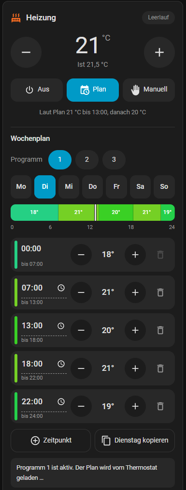
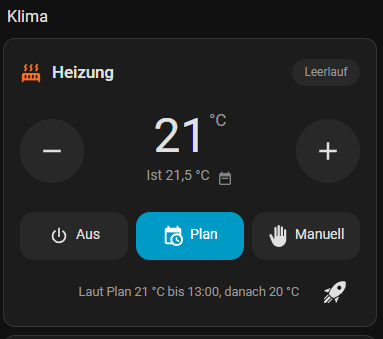
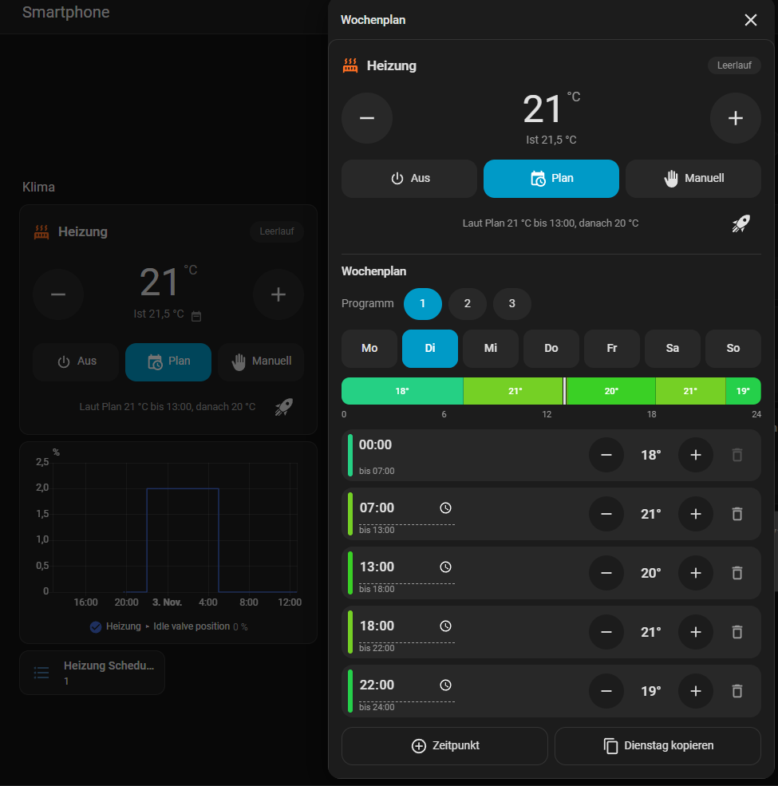

# Smart Heating Planer

[🇬🇧 English](README.md) · [🇩🇪 Deutsch](README.de.md) · [🇨🇿 Čeština](README.cs.md) · [🇸🇰 Slovenčina](README.sk.md) · [🇵🇱 Polski](README.pl.md) · 🇫🇷 Français

Une intégration Home Assistant avec une carte de thermostat qui permet de modifier directement, d'un simple toucher, le programme hebdomadaire de votre tête thermostatique. Aucun scheduler ni automatisation n'est nécessaire pour le programme : il est stocké dans le thermostat lui-même et continue de fonctionner même lorsque Home Assistant est injoignable.

<p align="center">
  
</p>

## Langues

La carte suit la langue définie dans votre profil Home Assistant (`hass.language`). L'anglais est la langue par défaut et de repli.

| Langue | Fichier |
|---|---|
| English (par défaut) | `translations/card/en.json` |
| Deutsch | `translations/card/de.json` |
| Čeština | `translations/card/cs.json` |
| Slovenčina | `translations/card/sk.json` |
| Polski | `translations/card/pl.json` |
| Français | `translations/card/fr.json` |

Les textes du config flow se trouvent dans `translations/<langue>.json`, ceux de la carte dans `translations/card/<langue>.json` (chargés par le navigateur à l'exécution).

**Ajouter une langue :** copiez `translations/card/en.json` vers `translations/card/<code>.json` et traduisez les valeurs (les clés de pluriel utilisent `.one` / `.few` / `.other`), ajoutez éventuellement `translations/<code>.json` pour le config flow, puis ajoutez le code à `SUPPORTED_LANGS` en haut de `frontend/smart-heating-planer-card.js`. Les clés manquantes retombent sur l'anglais.

## Fonctionnalités

La carte est conçue pour une utilisation au doigt : grands boutons, aucune édition YAML.

Elle existe en deux variantes :

| Carte | Contenu |
|---|---|
| **Smart Heating Planer** (`custom:smart-heating-planer-card`) | Thermostat et programme hebdomadaire l'un sous l'autre |
| **Smart Heating Planer (compacte)** (`custom:smart-heating-planer-compact-card`) | Thermostat uniquement. Un toucher sur la température entre − et + ouvre le programme hebdomadaire en vue détaillée. Fermeture avec ✕, un toucher à côté ou le bouton retour. |

<p align="center">
  
  &nbsp;
  
</p>
<p align="center"><em>À gauche la carte compacte, à droite la fenêtre du programme hebdomadaire après un toucher sur la température.</em></p>

**Thermostat (partie supérieure)**
- Grande température de consigne avec boutons −/+, la température actuelle en dessous. En haut à droite s'affiche si le chauffage chauffe ou est au repos.
- Plusieurs touchers sur −/+ sont regroupés et envoyés comme une seule commande. Cela ménage la batterie du thermostat.
- Mode **Arrêt**, **Programme** (auto, le thermostat suit le programme hebdomadaire) ou **Manuel** (température fixe).
- En mode Programme, la ligne en dessous indique ce qui s'applique actuellement, p. ex. « Selon le programme 21 °C jusqu'à 13:00, puis 20 °C ».
- **Boost (fusée en bas à droite) :** blanche = arrêté, orange-rouge = boost en cours. Un toucher le démarre ou l'arrête. Si le thermostat indique un temps restant, il s'affiche à côté de la fusée. La carte détecte le boost automatiquement :
  - Interrupteur `switch.*boost*` (p. ex. Moes BRT-100, Bosch BTH-RA)
  - Sélecteur `select.*_temporary_mode_mode` avec l'option `boost` (SONOFF TRV-ZBT/TRV-ZBL/TRVZB ; la durée du boost se règle sur l'appareil ou via `number.*_temporary_mode_duration`)
  - Preset `boost` du thermostat (beaucoup d'autres intégrations)

  Sans fonction boost, la fusée est masquée. Avec `boost_entity`, on peut définir l'entité à la main.

**Programme hebdomadaire (partie inférieure)**
- **Programme 1 / 2 / 3 :** pour les thermostats à plusieurs programmes, le programme actif se change d'un toucher. Le bouton est aussitôt mis en évidence et pulse jusqu'à ce que le thermostat confirme.
- **Lun–Dim :** touchez un jour pour voir son programme. Le jour actuel est entouré.
- **Frise horaire :** toute la journée sous forme de barre colorée (bleu = frais, vert/orange = chaud) avec un repère « maintenant ».
- **Points de commutation :** touchez l'heure pour la modifier (grille de 15 minutes), modifiez la température avec −/+ par pas de 0,5 °C, la corbeille supprime. Le premier point de commutation est toujours 00:00.
- **+ Heure** insère un nouveau point de commutation dans le plus grand intervalle de la journée.
- **Copier** applique le jour affiché d'un toucher à Lun–Ven, Sam–Dim ou tous les jours.
- Les jours modifiés reçoivent un point. Seul **Enregistrer** les envoie au thermostat, **Annuler** annule tout.

**Conditions (sous le programme hebdomadaire, aussi dans la fenêtre de la carte compacte)**

Avec les conditions, le thermostat réagit à d'autres appareils sans écrire d'automatisation. Exemple : *Si une présence est détectée, alors manuel 22 °C avec boost, et retour au programme dès que plus personne n'est là.*

- **Si :** choisissez une entité (capteur binaire, capteur, interrupteur, personne, assistant …) et touchez la condition. Pour les appareils marche/arrêt, des boutons adaptés existent, comme « détecté / non détecté » ou « ouvert / fermé ». Pour les capteurs numériques, il y a `>` `<` `=` `≠` et une valeur (virgule ou point), pour les entités de sélection une liste.
- **Alors :** **Manuel** avec une température (−/+ selon le pas du thermostat) ou **Arrêt**. En option **Démarrer le boost**.
- **Rétablir :** si l'option est activée, l'intégration restaure l'état précédent (programme/manuel/arrêt, température de consigne, boost arrêté) dès que la condition n'est plus remplie.
- Chaque condition peut être désactivée temporairement avec l'interrupteur de la liste. Un toucher l'ouvre pour la modifier ou la supprimer.
- Une condition actuellement active est entourée dans la liste. Dans les deux cartes, une icône apparaît en outre en bas à gauche.

Les conditions sont évaluées par l'intégration elle-même, donc aussi quand aucune carte n'est ouverte et après un redémarrage de Home Assistant. Elles sont stockées dans `.storage/smart_heating_planer.conditions`. Des états comme `unavailable` ou `unknown` ne déclenchent rien. Si plusieurs conditions s'appliquent au même thermostat, la dernière remplie l'emporte, et le rétablissement n'a lieu que lorsqu'aucune n'est plus remplie. Si vous modifiez quelque chose à la main sur le thermostat pendant une condition active, cela sera écrasé lors du rétablissement. Seuls les administrateurs peuvent créer et modifier des conditions.

**Coupler deux thermostats (depuis 1.4.0)**

Deux thermostats qui doivent toujours recevoir la même température/le même mode/le même programme hebdomadaire (p. ex. deux radiateurs dans la même pièce) peuvent être couplés de deux façons :

| | Sans groupe | Avec groupe |
|---|---|---|
| Configuration | Second thermostat dans l'éditeur de carte (`entity2`) | Section « Groupes de thermostats » sous le programme hebdomadaire |
| Nouvelle entité ? | Non | Oui, une entité `climate.*` dédiée |
| Utilisable hors de cette carte ? | Non, uniquement dans cette carte | Oui – autres tableaux de bord, automatisations, Google Home/Alexa |
| Suppression | Retirer l'option de configuration | Corbeille sur le groupe (supprime seulement l'entité de groupe, les deux thermostats restent) |

Dans les deux cas : la température, le mode et le boost vont aux deux thermostats en même temps, et le programme hebdomadaire est écrit dans les deux à l'enregistrement (chacun adapté à son propre profil). L'état affiché est toujours celui du premier thermostat ou, avec « avec groupe », l'état combiné des deux (identiques : repris, différents : valeur du premier). Une petite icône 🔗 à côté du nom indique avec quel thermostat le couplage est fait. Prérequis : les deux thermostats doivent fournir les entités texte du programme hebdomadaire dans le même format (voir le tableau ci-dessous) – sinon seuls la température/le mode/le boost sont couplés, pas le programme.

## Thermostats compatibles

La carte nécessite un thermostat connecté via **Zigbee2MQTT** qui fournit son programme hebdomadaire sous forme d'entités texte `text.<name>_weekly_schedule_<jour>` au format `HH:MM/température`. Les limites par modèle (nombre de points de commutation, plage de température) sont détectées automatiquement par la carte grâce au modèle dans le registre des appareils.

| Fabricant | Modèle | Points de commutation/jour | Température | Programmes 1–3 | Statut |
|---|---|---|---|---|---|
| SONOFF | TRV-ZBT (tête thermostatique) | 12 | 5–30 °C | ✅ | **testé** |
| SONOFF | TRV-ZBL | 12 | 5–30 °C | ✅ | même convertisseur Zigbee2MQTT que TRV-ZBT, non testé |
| SONOFF | TP-WGZBA (thermostat mural) | 12 | 5–30 °C | ✅ | même format que TRV-ZBT, non testé |
| SONOFF | TRVZB | 6 | 4–35 °C | – | compatible d'après le convertisseur Zigbee2MQTT, non testé |
| Bosch | BTH-RA (thermostat de radiateur II) | 10 | 5–30 °C | – | compatible d'après le convertisseur Zigbee2MQTT, non testé |

Le tableau repose sur les définitions d'appareils de Zigbee2MQTT 2.14 (zigbee-herdsman-converters). Pour les thermostats sans programmes, les boutons de programme ne sont simplement pas affichés.

**Non compatibles :**
- **Aqara W600 :** son programme hebdomadaire est composé de préréglages (`08:00/home, 19:00/away`), pas de températures.
- **Anciens thermostats Tuya, Immax et Saswell :** ils n'ont pas d'entités texte par jour mais leur propre format de programme.
- **Thermostats via ZHA, Homematic, tado°, Netatmo, etc. :** ils ne fournissent pas de programme hebdomadaire sous forme d'entités texte.

Pour tous les thermostats, la partie supérieure de la carte (température et mode) fonctionne, car elle n'utilise que l'entité `climate` normale. Sans entités de programme hebdomadaire, la carte affiche un message à la place du programme.

**Un autre thermostat Zigbee2MQTT avec le même format ?** Les modèles inconnus reçoivent des limites prudentes : 6 points de commutation, 5–30 °C. Si l'appareil autorise plus de points, vous pouvez le régler dans la carte avec `max_slots`. Je serai heureux de recevoir une issue avec le modèle et votre expérience.

## Prérequis

- Home Assistant 2025.1 ou plus récent
- Zigbee2MQTT avec la découverte Home Assistant activée
- Un thermostat compatible (voir ci-dessus)

## Installation

**HACS :** HACS → Dépôts personnalisés → ajoutez `https://github.com/thestealth131205/HA-SmartHeatingPlaner` avec le type « Intégration » → installez « Smart Heating Planer » → redémarrez Home Assistant.

**Manuellement :** copiez le dossier `custom_components/smart_heating_planer` dans `config/custom_components/` et redémarrez Home Assistant.

Ensuite : Paramètres → Appareils et services → Ajouter une intégration → **Smart Heating Planer**. La carte se charge automatiquement, aucune ressource de tableau de bord n'est à ajouter.

> **Astuce pour l'application Companion :** si l'application affiche « Custom element doesn't exist: smart-heating-planer-card », elle a encore une ancienne page d'accueil en cache. Ajoutez alors en plus l'URL `/smart_heating_planer/smart-heating-planer-card.js` comme module JavaScript sous Paramètres → Tableaux de bord → Ressources et fermez complètement l'application une fois.

Après une mise à jour, actualisez le navigateur avec Ctrl+F5 pour charger la nouvelle carte et les traductions.

## Ajouter la carte

Modifier le tableau de bord → Ajouter une carte → rechercher « Smart Heating Planer », ou via YAML :

```yaml
type: custom:smart-heating-planer-card          # ou custom:smart-heating-planer-compact-card
entity: climate.chauffage
entity2: climate.chauffage_2                    # optionnel, couplage « sans groupe » (voir ci-dessus)
name: Salon                                     # optionnel
max_slots: 6                                    # optionnel, seulement pour les thermostats inconnus de la carte
boost_entity: switch.chauffage_boost_heating    # optionnel, sinon automatique
```

Les entités du programme hebdomadaire et des programmes sont trouvées automatiquement via l'appareil du thermostat.

## Fonctionnement

La carte lit le programme dans les entités texte du thermostat, p. ex. :

```
00:00/18 07:00/21 13:00/20 18:00/21 22:00/19
```

À partir de 00:00, 18 °C s'appliquent, à partir de 07:00 21 °C, etc. ; la dernière valeur s'applique jusqu'à minuit. À l'enregistrement, la carte réécrit chaque jour modifié avec `text.set_value`. Pour le SONOFF TRV-ZBT, le jour est complété à 12 entrées en répétant le dernier point de commutation, ce qui correspond à la façon dont le thermostat rapporte lui-même son programme. Avec plusieurs programmes, la carte modifie simultanément `schedule_active_group` et `schedule_group_to_edit` lors du changement, de sorte que le programme affiché et enregistré appartient toujours au programme actif.

## Automatisations

Pour réagir à des événements (fenêtre ouverte, personne à la maison …), utilisez simplement des automatisations normales avec `climate.set_temperature` ou `climate.set_hvac_mode`. En mode *Programme*, le thermostat reprend ensuite son programme hebdomadaire.

Exemple : chauffage éteint tant que la fenêtre est ouverte.

```yaml
automation:
  - alias: Chauffage éteint si fenêtre ouverte
    triggers:
      - trigger: state
        entity_id: binary_sensor.fenetre_salon
        to: "on"
        for: "00:01:00"
    actions:
      - action: climate.set_hvac_mode
        target: { entity_id: climate.chauffage }
        data: { hvac_mode: "off" }
  - alias: Chauffage de nouveau selon le programme
    triggers:
      - trigger: state
        entity_id: binary_sensor.fenetre_salon
        to: "off"
    actions:
      - action: climate.set_hvac_mode
        target: { entity_id: climate.chauffage }
        data: { hvac_mode: auto }
```

## Licence

[GPL-3.0](LICENSE)
