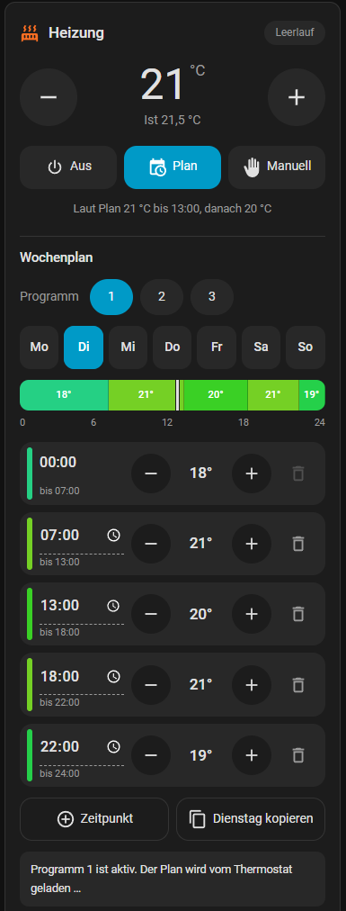
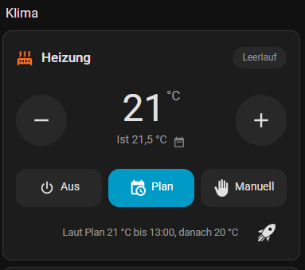
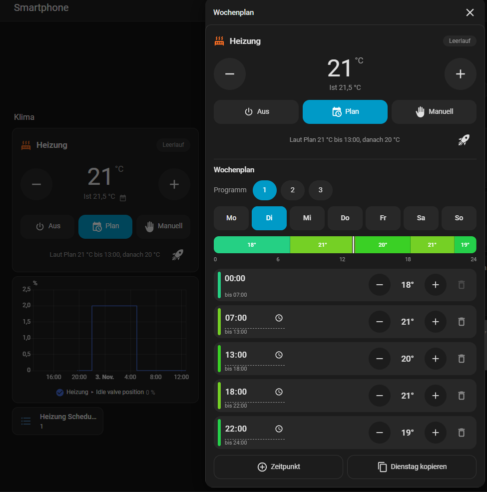

# Smart Heating Planer

🇬🇧 English · [🇩🇪 Deutsch](README.de.md) · [🇨🇿 Čeština](README.cs.md) · [🇸🇰 Slovenčina](README.sk.md) · [🇵🇱 Polski](README.pl.md) · [🇫🇷 Français](README.fr.md)

A Home Assistant integration with a thermostat card that lets you tap and edit the weekly schedule of your radiator thermostat directly. No scheduler or automations are needed for the schedule: it is stored in the thermostat itself and keeps running even when Home Assistant is unreachable.

<p align="center">
  
</p>

## Languages

The card follows the language set in your Home Assistant profile (`hass.language`). English is the default and the fallback.

| Language | File |
|---|---|
| English (default) | `translations/card/en.json` |
| Deutsch | `translations/card/de.json` |
| Čeština | `translations/card/cs.json` |
| Slovenčina | `translations/card/sk.json` |
| Polski | `translations/card/pl.json` |
| Français | `translations/card/fr.json` |

The config-flow texts live in `translations/<language>.json`, the card texts in `translations/card/<language>.json` (loaded by the browser at runtime).

**Adding a language:** copy `translations/card/en.json` to `translations/card/<code>.json` and translate the values (plural keys use `.one` / `.few` / `.other`), optionally add `translations/<code>.json` for the config flow, and append the code to `SUPPORTED_LANGS` at the top of `frontend/smart-heating-planer-card.js`. Missing keys fall back to English.

## Features

The card is built for finger operation: big buttons, no YAML editing.

It comes in two variants:

| Card | Content |
|---|---|
| **Smart Heating Planer** (`custom:smart-heating-planer-card`) | Thermostat and weekly schedule, one below the other |
| **Smart Heating Planer (compact)** (`custom:smart-heating-planer-compact-card`) | Thermostat only. Tapping the temperature between − and + opens the weekly schedule as a detail view. Close with ✕, a tap outside or the back button. |

<p align="center">
  
  &nbsp;
  
</p>
<p align="center"><em>Left: the compact card. Right: the weekly schedule dialog after tapping the temperature.</em></p>

**Thermostat (upper part)**
- Large target temperature with −/+ buttons, the current temperature below it. At the top right it shows whether the heating is currently heating or idle.
- Multiple taps on −/+ are collected and sent as a single command. This saves the thermostat's battery.
- Mode **Off**, **Schedule** (auto, the thermostat follows the weekly schedule) or **Manual** (fixed temperature).
- In schedule mode, the line below shows what currently applies, e.g. "Per schedule 21 °C until 13:00, then 20 °C".
- **Boost (rocket at the bottom right):** white = off, orange-red = boost running. A tap starts or ends it. If the thermostat reports a remaining time, it is shown next to the rocket. The card detects boost automatically:
  - Switch `switch.*boost*` (e.g. Moes BRT-100, Bosch BTH-RA)
  - Select `select.*_temporary_mode_mode` with option `boost` (SONOFF TRV-ZBT/TRV-ZBL/TRVZB; the boost duration is set on the device or via `number.*_temporary_mode_duration`)
  - Thermostat preset `boost` (many other integrations)

  Without a boost function the rocket is hidden. With `boost_entity` you can set the entity by hand.

**Weekly schedule (lower part)**
- **Program 1 / 2 / 3:** for thermostats with several programs, the active program is switched with one tap. The button is highlighted immediately and pulses until the thermostat confirms.
- **Mon–Sun:** tap a day to see its schedule. Today is outlined.
- **Timeline:** the whole day as a colored bar (blue = cool, green/orange = warm) with a marker for "now".
- **Switching points:** tap the time to change it (15-minute grid), change the temperature with −/+ in 0.5 °C steps, trash can to delete. The first switching point is always 00:00.
- **+ Time** inserts a new switching point into the largest gap of the day.
- **Copy** applies the displayed day to Mon–Fri, Sat–Sun or all days with one tap.
- Changed days get a dot. Only **Save** sends them to the thermostat, **Discard** reverts everything.

**Conditions (below the weekly schedule, also in the compact card's dialog)**

Conditions let the thermostat react to other devices without writing an automation. Example: *If presence is detected, then manual 22 °C with boost, and back to the schedule as soon as nobody is there anymore.*

- **If:** choose an entity (binary sensor, sensor, switch, person, helper …) and tap the condition. For on/off devices there are suitable buttons such as "detected / not detected" or "open / closed". For numeric sensors there are `>` `<` `=` `≠` and a value (comma or dot), for select entities a list.
- **Then:** **Manual** with a temperature (−/+ in the thermostat's step size) or **Off**. Optionally **Start boost**.
- **Reset:** if enabled, the integration restores the previous state (schedule/manual/off, target temperature, boost off) as soon as the condition is no longer met.
- Each condition can be temporarily disabled with the switch in the list. Tapping it opens it for editing or deleting.
- A currently active condition is outlined in the list. Both cards additionally show an icon at the bottom left.

Conditions are evaluated in the integration itself, so also when no card is open and after a Home Assistant restart. They are stored in `.storage/smart_heating_planer.conditions`. States such as `unavailable` or `unknown` trigger nothing. If several conditions apply to the same thermostat, the most recently met one wins, and the reset happens only when none is met anymore. If you change something on the thermostat by hand during an active condition, it is overwritten on reset. Only administrators may create and change conditions.

**Coupling two thermostats (since 1.4.0)**

Two thermostats that should always get the same temperature/mode/weekly schedule (e.g. two radiators in the same room) can be coupled in two ways:

| | Without group | With group |
|---|---|---|
| Setup | Second thermostat in the card editor (`entity2`) | "Thermostat groups" section below the weekly schedule |
| New entity? | No | Yes, a dedicated `climate.*` entity |
| Usable outside this card? | No, only in this card | Yes – other dashboards, automations, Google Home/Alexa |
| Deleting | Remove the config option | Trash can at the group (deletes only the group entity, both thermostats remain) |

In both cases: temperature, mode and boost go to both thermostats at the same time, and the weekly schedule is written to both on save (each tailored to its own profile). The displayed state is always that of the first thermostat or – with "with group" – the combined state of both (equal: adopt it, different: value of the first). A small 🔗 icon next to the name shows which thermostat it is coupled with. Prerequisite: both thermostats must provide the weekly-schedule text entities in the same format (see the table below) – otherwise only temperature/mode/boost are coupled, not the schedule.

## Compatible thermostats

The card needs a thermostat connected via **Zigbee2MQTT** that provides its weekly schedule as text entities `text.<name>_weekly_schedule_<day>` in the format `HH:MM/temperature`. The card detects the per-model limits (number of switching points, temperature range) automatically from the model in the device registry.

| Manufacturer | Model | Switching points/day | Temperature | Programs 1–3 | Status |
|---|---|---|---|---|---|
| SONOFF | TRV-ZBT (thermostat head) | 12 | 5–30 °C | ✅ | **tested** |
| SONOFF | TRV-ZBL | 12 | 5–30 °C | ✅ | same Zigbee2MQTT converter as TRV-ZBT, not tested |
| SONOFF | TP-WGZBA (wall thermostat) | 12 | 5–30 °C | ✅ | same format as TRV-ZBT, not tested |
| SONOFF | TRVZB | 6 | 4–35 °C | – | compatible per Zigbee2MQTT converter, not tested |
| Bosch | BTH-RA (radiator thermostat II) | 10 | 5–30 °C | – | compatible per Zigbee2MQTT converter, not tested |

The table is based on the device definitions of Zigbee2MQTT 2.14 (zigbee-herdsman-converters). For thermostats without programs, the program buttons are simply not shown.

**Not compatible:**
- **Aqara W600:** its weekly schedule consists of presets (`08:00/home, 19:00/away`), not temperatures.
- **Older Tuya, Immax and Saswell thermostats:** they have no per-day text entities but their own schedule format.
- **Thermostats via ZHA, Homematic, tado°, Netatmo etc.:** they do not provide a weekly schedule as text entities.

For all thermostats the upper part of the card (temperature and mode) works, because it only uses the normal `climate` entity. Without weekly-schedule entities the card shows a notice instead of the schedule.

**Another Zigbee2MQTT thermostat with the same format?** Unknown models get cautious limits: 6 switching points, 5–30 °C. If the device allows more switching points, you can set that in the card with `max_slots`. I'd be happy about an issue with the model and your experience.

## Requirements

- Home Assistant 2025.1 or newer
- Zigbee2MQTT with Home Assistant discovery enabled
- A compatible thermostat (see above)

## Installation

**HACS:** HACS → Custom repositories → add `https://github.com/thestealth131205/HA-SmartHeatingPlaner` with type "Integration" → install "Smart Heating Planer" → restart Home Assistant.

**Manual:** copy the folder `custom_components/smart_heating_planer` to `config/custom_components/` and restart Home Assistant.

Then: Settings → Devices & services → Add integration → **Smart Heating Planer**. The card is loaded automatically, no dashboard resource needs to be added.

> **Tip for the Companion app:** if the app shows "Custom element doesn't exist: smart-heating-planer-card", it still has an old start page in its cache. Then additionally add the URL `/smart_heating_planer/smart-heating-planer-card.js` as a JavaScript module under Settings → Dashboards → Resources and close the app completely once.

After an update, refresh the browser with Ctrl+F5 so the new card and translations are loaded.

## Adding the card

Edit dashboard → Add card → search for "Smart Heating Planer", or via YAML:

```yaml
type: custom:smart-heating-planer-card          # or custom:smart-heating-planer-compact-card
entity: climate.heating
entity2: climate.heating_2                      # optional, coupling "without group" (see above)
name: Living room                               # optional
max_slots: 6                                    # optional, only for thermostats the card doesn't know
boost_entity: switch.heating_boost_heating      # optional, otherwise automatic
```

The weekly-schedule and program entities are found automatically via the thermostat's device.

## How it works

The card reads the schedule from the thermostat's text entities, e.g.:

```
00:00/18 07:00/21 13:00/20 18:00/21 22:00/19
```

From 00:00 18 °C applies, from 07:00 21 °C and so on; the last value applies until midnight. On save, the card writes each changed day back with `text.set_value`. For the SONOFF TRV-ZBT the day is padded to 12 entries by repeating the last switching point, which is also how the thermostat reports its schedule itself. With several programs, the card switches `schedule_active_group` and `schedule_group_to_edit` at the same time when changing the program, so the displayed and saved schedule always belongs to the active program.

## Automations

For reactions to events (window open, nobody home …) just use normal automations with `climate.set_temperature` or `climate.set_hvac_mode`. In *Schedule* mode the thermostat then takes over its weekly schedule again.

Example: heating off while the window is open.

```yaml
automation:
  - alias: Heating off when window is open
    triggers:
      - trigger: state
        entity_id: binary_sensor.window_living_room
        to: "on"
        for: "00:01:00"
    actions:
      - action: climate.set_hvac_mode
        target: { entity_id: climate.heating }
        data: { hvac_mode: "off" }
  - alias: Heating back to schedule
    triggers:
      - trigger: state
        entity_id: binary_sensor.window_living_room
        to: "off"
    actions:
      - action: climate.set_hvac_mode
        target: { entity_id: climate.heating }
        data: { hvac_mode: auto }
```

## License

[GPL-3.0](LICENSE)
