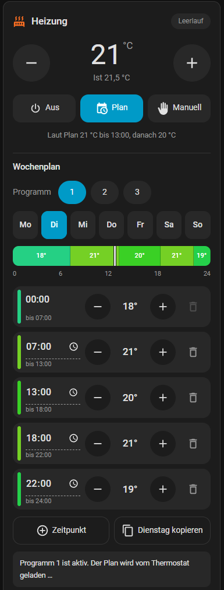
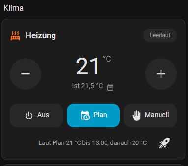
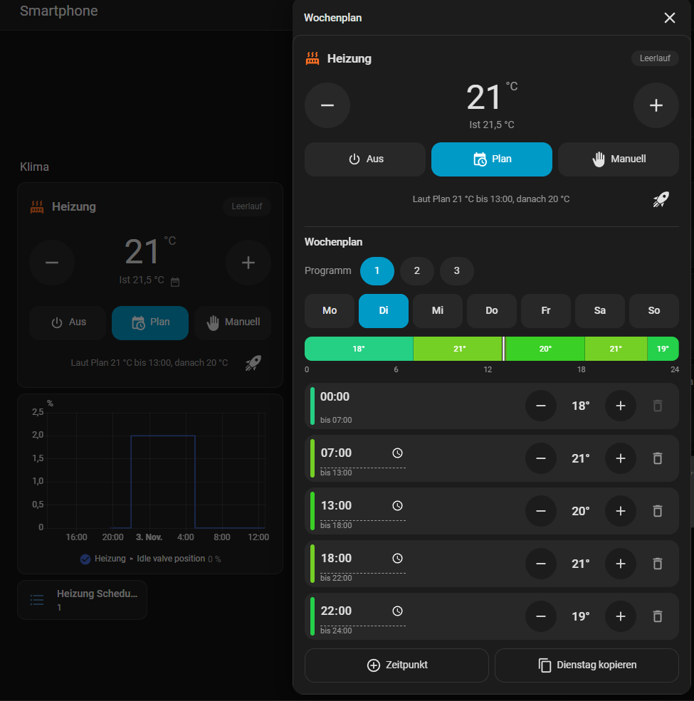

# Smart Heating Planer

Eine Home-Assistant-Integration mit einer Thermostat-Karte, in der man den Wochenplan seines Heizkörperthermostats direkt antippen und ändern kann. Ein Scheduler oder Automationen für den Zeitplan sind nicht nötig: Der Plan liegt im Thermostat selbst und läuft auch weiter, wenn Home Assistant einmal nicht erreichbar ist.

<p align="center">
  
</p>

## Funktionen

Die Karte ist für die Bedienung mit dem Finger gebaut: große Knöpfe, keine YAML-Bearbeitung.

Es gibt sie in zwei Varianten:

| Karte | Inhalt |
|---|---|
| **Smart Heating Planer** (`custom:smart-heating-planer-card`) | Thermostat und Wochenplan untereinander |
| **Smart Heating Planer (kompakt)** (`custom:smart-heating-planer-compact-card`) | nur das Thermostat. Ein Tipp auf die Temperatur zwischen − und + öffnet den Wochenplan als Detailansicht. Schließen mit ✕, Tipp daneben oder der Zurück-Taste. |

<p align="center">
  
  &nbsp;
  
</p>
<p align="center"><em>Links die kompakte Karte, rechts der Wochenplan-Dialog nach einem Tipp auf die Temperatur.</em></p>

**Thermostat (oberer Teil)**
- Große Solltemperatur mit −/+-Knöpfen, darunter die Ist-Temperatur. Oben rechts steht, ob die Heizung gerade heizt oder im Leerlauf ist.
- Mehrfaches Tippen auf −/+ wird gesammelt und als ein einziger Befehl gesendet. Das schont die Batterie des Thermostats.
- Modus **Aus**, **Plan** (Auto, das Thermostat folgt dem Wochenplan) oder **Manuell** (feste Temperatur).
- Im Plan-Modus steht darunter, was gerade gilt, z. B. „Laut Plan 21 °C bis 13:00, danach 20 °C“.
- **Boost (Rakete unten rechts):** weiß = aus, orange-rot = Boost läuft. Ein Tipp startet oder beendet ihn. Meldet das Thermostat eine Restzeit, steht sie neben der Rakete. Die Karte erkennt den Boost automatisch:
  - Schalter `switch.*boost*` (z. B. Moes BRT-100, Bosch BTH-RA)
  - Auswahl `select.*_temporary_mode_mode` mit Option `boost` (SONOFF TRV-ZBT/TRV-ZBL/TRVZB, Boost-Dauer stellt man am Gerät bzw. über `number.*_temporary_mode_duration` ein)
  - Preset `boost` des Thermostats (viele andere Integrationen)
  
  Ohne Boost-Funktion bleibt die Rakete weg. Mit `boost_entity` lässt sich die Entity von Hand festlegen.

**Wochenplan (unterer Teil)**
- **Programm 1 / 2 / 3:** Bei Thermostaten mit mehreren Programmen wird das aktive Programm mit einem Tipp umgeschaltet. Der Knopf ist sofort markiert und pulsiert, bis das Thermostat bestätigt.
- **Mo–So:** Tag antippen, um seinen Plan zu sehen. Der heutige Tag ist umrandet.
- **Zeitleiste:** Der ganze Tag als farbiger Balken (blau = kühl, grün/orange = warm) mit einem Strich für „jetzt“.
- **Schaltpunkte:** Uhrzeit antippen zum Ändern (15-Minuten-Raster), Temperatur mit −/+ in 0,5-°C-Schritten, Mülleimer zum Löschen. Der erste Schaltpunkt ist immer 00:00.
- **+ Zeitpunkt** fügt einen neuen Schaltpunkt in die größte Lücke des Tages ein.
- **Kopieren** übernimmt den angezeigten Tag mit einem Tipp auf Mo–Fr, Sa–So oder alle Tage.
- Geänderte Tage bekommen einen Punkt. Erst **Speichern** schickt sie an das Thermostat, **Verwerfen** macht alles rückgängig.

## Kompatible Thermostate

Die Karte braucht ein Thermostat, das über **Zigbee2MQTT** angebunden ist und seinen Wochenplan als Text-Entities `text.<name>_weekly_schedule_<tag>` im Format `HH:MM/Temperatur` bereitstellt. Die Grenzen pro Modell (Anzahl Schaltpunkte, Temperaturbereich) erkennt die Karte automatisch über das Modell in der Geräte-Registry.

| Hersteller | Modell | Schaltpunkte/Tag | Temperatur | Programme 1–3 | Status |
|---|---|---|---|---|---|
| SONOFF | TRV-ZBT (Thermostat-Kopf) | 12 | 5–30 °C | ✅ | **getestet** |
| SONOFF | TRV-ZBL | 12 | 5–30 °C | ✅ | gleicher Zigbee2MQTT-Konverter wie TRV-ZBT, nicht getestet |
| SONOFF | TP-WGZBA (Wand-Thermostat) | 12 | 5–30 °C | ✅ | gleiches Format wie TRV-ZBT, nicht getestet |
| SONOFF | TRVZB | 6 | 4–35 °C | – | laut Zigbee2MQTT-Konverter kompatibel, nicht getestet |
| Bosch | BTH-RA (Heizkörper-Thermostat II) | 10 | 5–30 °C | – | laut Zigbee2MQTT-Konverter kompatibel, nicht getestet |

Grundlage der Tabelle sind die Gerätedefinitionen von Zigbee2MQTT 2.14 (zigbee-herdsman-converters). Bei Thermostaten ohne Programme werden die Programm-Knöpfe einfach nicht angezeigt.

**Nicht kompatibel:**
- **Aqara W600:** Der Wochenplan besteht dort aus Voreinstellungen (`08:00/home, 19:00/away`), nicht aus Temperaturen.
- **Ältere Tuya-, Immax- und Saswell-Thermostate:** Sie haben keine Text-Entities pro Tag, sondern ein eigenes Planformat.
- **Thermostate über ZHA, Homematic, tado°, Netatmo usw.:** Sie stellen keinen Wochenplan als Text-Entities bereit.

Bei allen Thermostaten funktioniert der obere Teil der Karte (Temperatur und Modus), weil er nur die normale `climate`-Entity nutzt. Ohne Wochenplan-Entities zeigt die Karte statt des Plans einen Hinweis.

**Anderes Zigbee2MQTT-Thermostat mit gleichem Format?** Unbekannte Modelle bekommen vorsichtige Grenzen: 6 Schaltpunkte, 5–30 °C. Erlaubt das Gerät mehr Schaltpunkte, kannst du das in der Karte mit `max_slots` einstellen. Über ein Issue mit Modell und Erfahrungen freue ich mich.

## Voraussetzungen

- Home Assistant ab 2025.1
- Zigbee2MQTT mit aktivierter Home-Assistant-Discovery
- Ein kompatibles Thermostat (siehe oben)

## Installation

**HACS:** HACS → Benutzerdefinierte Repositories → `https://github.com/thestealth131205/HA-SmartHeatingPlaner` mit Typ „Integration“ hinzufügen → „Smart Heating Planer“ installieren → Home Assistant neu starten.

**Manuell:** Den Ordner `custom_components/smart_heating_planer` nach `config/custom_components/` kopieren und Home Assistant neu starten.

Danach: Einstellungen → Geräte & Dienste → Integration hinzufügen → **Smart Heating Planer**. Die Karte wird automatisch geladen, eine Dashboard-Ressource muss nicht eingetragen werden.

> **Tipp für die Companion-App:** Zeigt die App „Custom element doesn't exist: smart-heating-planer-card“, hat sie noch eine alte Startseite im Cache. Dann zusätzlich unter Einstellungen → Dashboards → Ressourcen die URL `/smart_heating_planer/smart-heating-planer-card.js` als JavaScript-Modul eintragen und die App einmal ganz schließen.

## Karte einbinden

Dashboard bearbeiten → Karte hinzufügen → „Smart Heating Planer“ suchen, oder per YAML:

```yaml
type: custom:smart-heating-planer-card          # oder custom:smart-heating-planer-compact-card
entity: climate.heizung
name: Wohnzimmer                                # optional
max_slots: 6                                    # optional, nur für Thermostate, die die Karte nicht kennt
boost_entity: switch.heizung_boost_heating      # optional, sonst automatisch
```

Die Wochenplan- und Programm-Entities werden automatisch über das Gerät des Thermostats gefunden.

## So funktioniert es

Die Karte liest den Plan aus den Text-Entities des Thermostats, z. B.:

```
00:00/18 07:00/21 13:00/20 18:00/21 22:00/19
```

Ab 00:00 gelten 18 °C, ab 07:00 21 °C usw., der letzte Wert gilt bis Mitternacht. Beim Speichern schreibt die Karte jeden geänderten Tag mit `text.set_value` zurück. Beim SONOFF TRV-ZBT wird der Tag dabei auf 12 Einträge aufgefüllt, indem der letzte Schaltpunkt wiederholt wird. So meldet das Thermostat seinen Plan auch selbst. Bei mehreren Programmen stellt die Karte beim Umschalten `schedule_active_group` und `schedule_group_to_edit` gleichzeitig um. So gehört der angezeigte und gespeicherte Plan immer zum aktiven Programm.

## Automationen

Für Reaktionen auf Ereignisse (Fenster offen, niemand zu Hause …) einfach normale Automationen mit `climate.set_temperature` oder `climate.set_hvac_mode` verwenden. Im Modus *Plan* übernimmt das Thermostat danach wieder seinen Wochenplan.

Beispiel: Heizung aus, solange das Fenster offen ist.

```yaml
automation:
  - alias: Heizung aus bei offenem Fenster
    triggers:
      - trigger: state
        entity_id: binary_sensor.fenster_wohnzimmer
        to: "on"
        for: "00:01:00"
    actions:
      - action: climate.set_hvac_mode
        target: { entity_id: climate.heizung }
        data: { hvac_mode: "off" }
  - alias: Heizung wieder nach Plan
    triggers:
      - trigger: state
        entity_id: binary_sensor.fenster_wohnzimmer
        to: "off"
    actions:
      - action: climate.set_hvac_mode
        target: { entity_id: climate.heizung }
        data: { hvac_mode: auto }
```

## Lizenz

[GPL-3.0](LICENSE)
