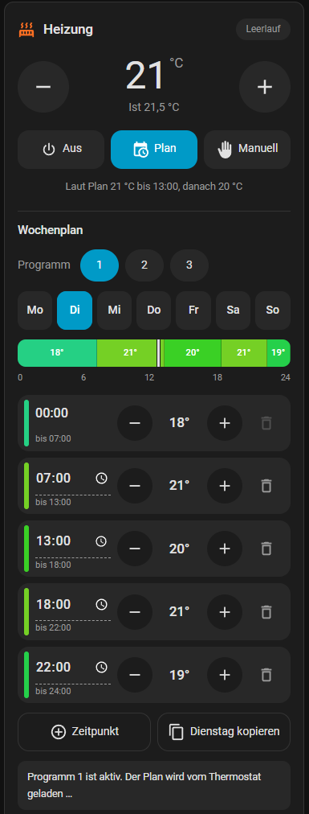
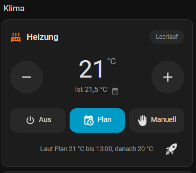
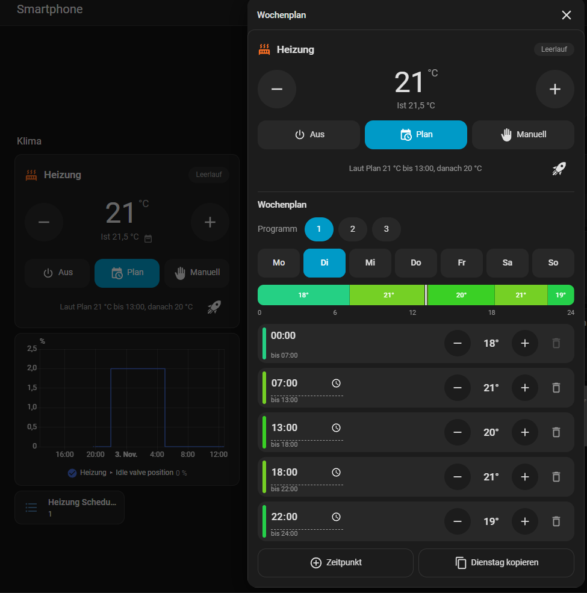

# Smart Heating Planer

[🇬🇧 English](README.md) · [🇩🇪 Deutsch](README.de.md) · [🇨🇿 Čeština](README.cs.md) · [🇸🇰 Slovenčina](README.sk.md) · 🇵🇱 Polski · [🇫🇷 Français](README.fr.md)

Integracja dla Home Assistant z kartą termostatu, na której tygodniowy harmonogram termostatu grzejnikowego można edytować bezpośrednio dotykiem. Do harmonogramu nie są potrzebne żadne schedulery ani automatyzacje: plan jest zapisany w samym termostacie i działa dalej, nawet gdy Home Assistant jest niedostępny.

<p align="center">
  
</p>

## Języki

Karta stosuje język ustawiony w profilu Home Assistant (`hass.language`). Językiem domyślnym i zapasowym jest angielski.

| Język | Plik |
|---|---|
| English (domyślny) | `translations/card/en.json` |
| Deutsch | `translations/card/de.json` |
| Čeština | `translations/card/cs.json` |
| Slovenčina | `translations/card/sk.json` |
| Polski | `translations/card/pl.json` |
| Français | `translations/card/fr.json` |

Teksty konfiguratora są w `translations/<język>.json`, teksty karty w `translations/card/<język>.json` (przeglądarka ładuje je w trakcie działania).

**Dodawanie języka:** skopiuj `translations/card/en.json` do `translations/card/<kod>.json` i przetłumacz wartości (klucze liczby mnogiej używają `.one` / `.few` / `.other`), opcjonalnie dodaj `translations/<kod>.json` dla konfiguratora i dopisz kod do `SUPPORTED_LANGS` na początku `frontend/smart-heating-planer-card.js`. Brakujące klucze są zastępowane angielskimi.

## Funkcje

Karta jest zaprojektowana do obsługi palcem: duże przyciski, bez edycji YAML.

Występuje w dwóch wariantach:

| Karta | Zawartość |
|---|---|
| **Smart Heating Planer** (`custom:smart-heating-planer-card`) | Termostat i harmonogram tygodniowy jeden pod drugim |
| **Smart Heating Planer (kompaktowa)** (`custom:smart-heating-planer-compact-card`) | Tylko termostat. Dotknięcie temperatury między − a + otwiera harmonogram tygodniowy jako widok szczegółowy. Zamykanie przez ✕, dotknięcie poza oknem lub przycisk wstecz. |

<p align="center">
  
  &nbsp;
  
</p>
<p align="center"><em>Po lewej karta kompaktowa, po prawej okno harmonogramu tygodniowego po dotknięciu temperatury.</em></p>

**Termostat (górna część)**
- Duża temperatura zadana z przyciskami −/+, pod nią temperatura rzeczywista. U góry po prawej widać, czy ogrzewanie właśnie grzeje, czy jest w bezczynności.
- Wielokrotne dotknięcia −/+ są zbierane i wysyłane jako jedno polecenie. Oszczędza to baterię termostatu.
- Tryb **Wył.**, **Harmonogram** (auto, termostat podąża za harmonogramem tygodniowym) lub **Ręczny** (stała temperatura).
- W trybie Harmonogram poniżej widać, co aktualnie obowiązuje, np. „Wg harmonogramu 21 °C do 13:00, potem 20 °C”.
- **Boost (rakieta u dołu po prawej):** biała = wyłączony, pomarańczowoczerwona = boost trwa. Dotknięcie uruchamia go lub kończy. Jeśli termostat podaje pozostały czas, jest on wyświetlany obok rakiety. Karta rozpoznaje boost automatycznie:
  - Przełącznik `switch.*boost*` (np. Moes BRT-100, Bosch BTH-RA)
  - Lista wyboru `select.*_temporary_mode_mode` z opcją `boost` (SONOFF TRV-ZBT/TRV-ZBL/TRVZB; czas boostu ustawia się na urządzeniu lub przez `number.*_temporary_mode_duration`)
  - Preset `boost` termostatu (wiele innych integracji)

  Bez funkcji boost rakieta jest ukryta. Za pomocą `boost_entity` można ustawić encję ręcznie.

**Harmonogram tygodniowy (dolna część)**
- **Program 1 / 2 / 3:** w termostatach z kilkoma programami aktywny program przełącza się jednym dotknięciem. Przycisk jest od razu podświetlony i pulsuje, dopóki termostat nie potwierdzi zmiany.
- **Pn–Nd:** dotknij dnia, aby zobaczyć jego harmonogram. Dzisiejszy dzień jest obramowany.
- **Oś czasu:** cały dzień jako kolorowy pasek (niebieski = chłodno, zielony/pomarańczowy = ciepło) ze znacznikiem „teraz”.
- **Punkty przełączania:** dotknij godziny, aby ją zmienić (siatka 15 minut), temperaturę zmieniasz przyciskami −/+ co 0,5 °C, kosz usuwa. Pierwszy punkt przełączania to zawsze 00:00.
- **+ Godzina** wstawia nowy punkt przełączania w największą lukę dnia.
- **Kopiuj** przenosi wyświetlany dzień jednym dotknięciem na Pn–Pt, Sb–Nd lub wszystkie dni.
- Zmienione dni otrzymują kropkę. Dopiero **Zapisz** wysyła je do termostatu, **Odrzuć** cofa wszystko.

**Warunki (poniżej harmonogramu tygodniowego, także w oknie karty kompaktowej)**

Dzięki warunkom termostat reaguje na inne urządzenia bez pisania automatyzacji. Przykład: *Jeśli wykryto obecność, to ręcznie 22 °C z boostem, a po wyjściu wszystkich z powrotem na harmonogram.*

- **Jeśli:** wybierz encję (czujnik binarny, czujnik, przełącznik, osoba, pomocnik …) i dotknij warunku. Dla urządzeń wł./wył. dostępne są odpowiednie przyciski, np. „wykryto / nie wykryto” lub „otwarte / zamknięte”. Dla czujników liczbowych są `>` `<` `=` `≠` oraz wartość (przecinek lub kropka), dla encji z wyborem lista.
- **Wtedy:** **Ręczny** z temperaturą (−/+ w kroku termostatu) lub **Wył.** Opcjonalnie **Uruchom boost**.
- **Przywróć:** gdy opcja jest włączona, integracja przywraca poprzedni stan (harmonogram/ręczny/wył., temperaturę zadaną, boost wył.), gdy tylko warunek przestaje być spełniony.
- Każdy warunek można tymczasowo wyłączyć przełącznikiem na liście. Dotknięcie otwiera go do edycji lub usunięcia.
- Aktualnie aktywny warunek jest na liście obramowany. W obu kartach dodatkowo pojawia się ikona u dołu po lewej.

Warunki są oceniane w samej integracji, czyli także gdy żadna karta nie jest otwarta i po ponownym uruchomieniu Home Assistant. Są zapisane w `.storage/smart_heating_planer.conditions`. Stany takie jak `unavailable` lub `unknown` niczego nie uruchamiają. Jeśli dla jednego termostatu obowiązuje kilka warunków, wygrywa ostatnio spełniony, a przywrócenie następuje dopiero, gdy żaden nie jest spełniony. Jeśli podczas aktywnego warunku zmienisz coś ręcznie w termostacie, zostanie to nadpisane przy przywracaniu. Tworzyć i zmieniać warunki mogą tylko administratorzy.

**Łączenie dwóch termostatów (od 1.4.0)**

Dwa termostaty, które zawsze mają dostawać tę samą temperaturę/tryb/harmonogram tygodniowy (np. dwa grzejniki w tym samym pomieszczeniu), można połączyć na dwa sposoby:

| | Bez grupy | Z grupą |
|---|---|---|
| Konfiguracja | Drugi termostat w edytorze karty (`entity2`) | Sekcja „Grupy termostatów” pod harmonogramem tygodniowym |
| Nowa encja? | Nie | Tak, własna encja `climate.*` |
| Użyteczne poza tą kartą? | Nie, tylko w tej karcie | Tak – inne dashboardy, automatyzacje, Google Home/Alexa |
| Usuwanie | Usunąć opcję z konfiguracji | Kosz przy grupie (usuwa tylko encję grupy, oba termostaty pozostają) |

W obu przypadkach: temperatura, tryb i boost trafiają jednocześnie do obu termostatów, a harmonogram tygodniowy jest przy zapisie zapisywany w obu (każdy dopasowany do własnego profilu). Wyświetlany jest zawsze stan pierwszego termostatu, a przy „z grupą” – połączony stan obu (takie same: przejąć, różne: wartość pierwszego). Mała ikona 🔗 obok nazwy pokazuje, z którym termostatem jest połączenie. Warunek: oba termostaty muszą udostępniać tekstowe encje harmonogramu tygodniowego w tym samym formacie (zob. tabela poniżej) – w przeciwnym razie połączone są tylko temperatura/tryb/boost, a nie harmonogram.

## Zgodne termostaty

Karta wymaga termostatu podłączonego przez **Zigbee2MQTT**, który udostępnia harmonogram tygodniowy jako tekstowe encje `text.<name>_weekly_schedule_<dzień>` w formacie `HH:MM/temperatura`. Limity dla poszczególnych modeli (liczba punktów przełączania, zakres temperatur) karta rozpoznaje automatycznie na podstawie modelu w rejestrze urządzeń.

| Producent | Model | Punktów przełączania/dzień | Temperatura | Programy 1–3 | Status |
|---|---|---|---|---|---|
| SONOFF | TRV-ZBT (głowica termostatyczna) | 12 | 5–30 °C | ✅ | **przetestowano** |
| SONOFF | TRV-ZBL | 12 | 5–30 °C | ✅ | ten sam konwerter Zigbee2MQTT co TRV-ZBT, nie testowano |
| SONOFF | TP-WGZBA (termostat ścienny) | 12 | 5–30 °C | ✅ | ten sam format co TRV-ZBT, nie testowano |
| SONOFF | TRVZB | 6 | 4–35 °C | – | zgodny wg konwertera Zigbee2MQTT, nie testowano |
| Bosch | BTH-RA (termostat grzejnikowy II) | 10 | 5–30 °C | – | zgodny wg konwertera Zigbee2MQTT, nie testowano |

Tabela opiera się na definicjach urządzeń Zigbee2MQTT 2.14 (zigbee-herdsman-converters). W termostatach bez programów przyciski programów po prostu się nie wyświetlają.

**Niezgodne:**
- **Aqara W600:** harmonogram tygodniowy składa się tam z ustawień wstępnych (`08:00/home, 19:00/away`), a nie z temperatur.
- **Starsze termostaty Tuya, Immax i Saswell:** nie mają tekstowych encji dla poszczególnych dni, lecz własny format harmonogramu.
- **Termostaty przez ZHA, Homematic, tado°, Netatmo itp.:** nie udostępniają harmonogramu tygodniowego jako encji tekstowych.

Dla wszystkich termostatów działa górna część karty (temperatura i tryb), ponieważ korzysta tylko ze zwykłej encji `climate`. Bez encji harmonogramu tygodniowego karta zamiast harmonogramu pokazuje komunikat.

**Inny termostat Zigbee2MQTT z tym samym formatem?** Nieznane modele otrzymują ostrożne limity: 6 punktów przełączania, 5–30 °C. Jeśli urządzenie dopuszcza więcej punktów, możesz to ustawić w karcie za pomocą `max_slots`. Ucieszę się z zgłoszenia (issue) z modelem i Twoimi doświadczeniami.

## Wymagania

- Home Assistant 2025.1 lub nowszy
- Zigbee2MQTT z włączonym Home Assistant Discovery
- Zgodny termostat (zob. wyżej)

## Instalacja

**HACS:** HACS → Własne repozytoria → dodaj `https://github.com/thestealth131205/HA-SmartHeatingPlaner` z typem „Integracja” → zainstaluj „Smart Heating Planer” → uruchom ponownie Home Assistant.

**Ręcznie:** skopiuj folder `custom_components/smart_heating_planer` do `config/custom_components/` i uruchom ponownie Home Assistant.

Następnie: Ustawienia → Urządzenia i usługi → Dodaj integrację → **Smart Heating Planer**. Karta ładuje się automatycznie, nie trzeba dodawać zasobu dashboardu.

> **Wskazówka dla aplikacji Companion:** jeśli aplikacja pokazuje „Custom element doesn't exist: smart-heating-planer-card”, ma w pamięci podręcznej starą stronę startową. Wtedy dodatkowo dodaj w Ustawienia → Dashboardy → Zasoby adres `/smart_heating_planer/smart-heating-planer-card.js` jako moduł JavaScript i raz całkowicie zamknij aplikację.

Po aktualizacji odśwież przeglądarkę przez Ctrl+F5, aby załadować nową kartę i tłumaczenia.

## Dodawanie karty

Edytuj dashboard → Dodaj kartę → wyszukaj „Smart Heating Planer”, lub przez YAML:

```yaml
type: custom:smart-heating-planer-card          # lub custom:smart-heating-planer-compact-card
entity: climate.ogrzewanie
entity2: climate.ogrzewanie_2                   # opcjonalnie, połączenie „bez grupy” (zob. wyżej)
name: Salon                                     # opcjonalnie
max_slots: 6                                    # opcjonalnie, tylko dla termostatów nieznanych karcie
boost_entity: switch.ogrzewanie_boost_heating   # opcjonalnie, inaczej automatycznie
```

Encje harmonogramu tygodniowego i programów są znajdowane automatycznie przez urządzenie termostatu.

## Jak to działa

Karta odczytuje harmonogram z tekstowych encji termostatu, np.:

```
00:00/18 07:00/21 13:00/20 18:00/21 22:00/19
```

Od 00:00 obowiązuje 18 °C, od 07:00 21 °C itd., ostatnia wartość obowiązuje do północy. Przy zapisie karta zapisuje każdy zmieniony dzień z powrotem za pomocą `text.set_value`. W SONOFF TRV-ZBT dzień jest uzupełniany do 12 wpisów przez powtórzenie ostatniego punktu przełączania – tak samo swój plan zgłasza sam termostat. Przy kilku programach karta przy przełączaniu zmienia jednocześnie `schedule_active_group` i `schedule_group_to_edit`, dzięki czemu wyświetlany i zapisywany harmonogram zawsze należy do aktywnego programu.

## Automatyzacje

Do reakcji na zdarzenia (otwarte okno, nikogo w domu …) wystarczą zwykłe automatyzacje z `climate.set_temperature` lub `climate.set_hvac_mode`. W trybie *Harmonogram* termostat następnie ponownie przejmuje swój harmonogram tygodniowy.

Przykład: ogrzewanie wyłączone, dopóki okno jest otwarte.

```yaml
automation:
  - alias: Ogrzewanie wyłączone przy otwartym oknie
    triggers:
      - trigger: state
        entity_id: binary_sensor.okno_salon
        to: "on"
        for: "00:01:00"
    actions:
      - action: climate.set_hvac_mode
        target: { entity_id: climate.ogrzewanie }
        data: { hvac_mode: "off" }
  - alias: Ogrzewanie z powrotem wg harmonogramu
    triggers:
      - trigger: state
        entity_id: binary_sensor.okno_salon
        to: "off"
    actions:
      - action: climate.set_hvac_mode
        target: { entity_id: climate.ogrzewanie }
        data: { hvac_mode: auto }
```

## Licencja

[GPL-3.0](LICENSE)
