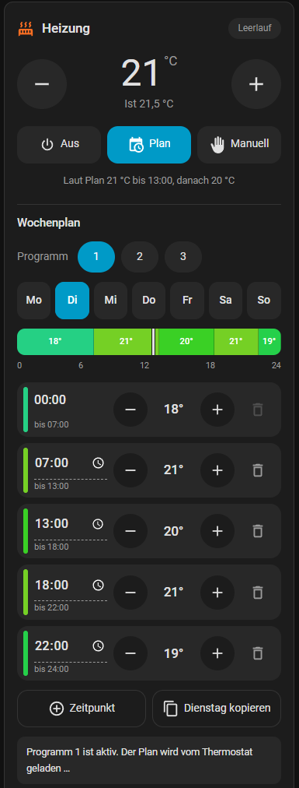
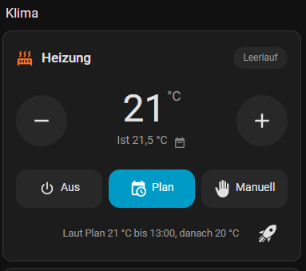
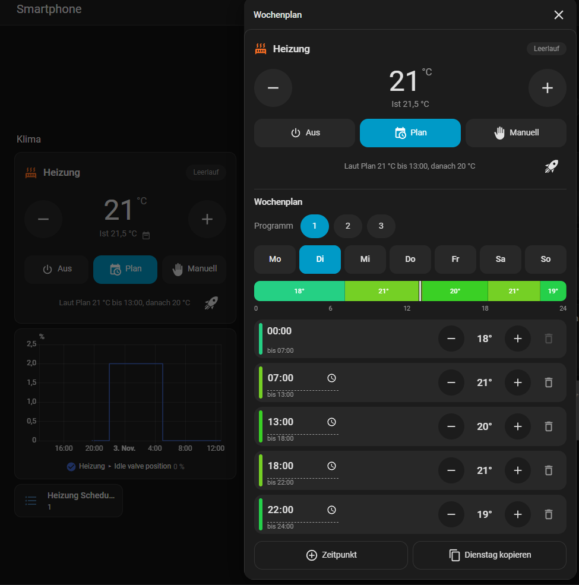

# Smart Heating Planer

[🇬🇧 English](README.md) · [🇩🇪 Deutsch](README.de.md) · [🇨🇿 Čeština](README.cs.md) · 🇸🇰 Slovenčina · [🇵🇱 Polski](README.pl.md) · [🇫🇷 Français](README.fr.md)

Integrácia pre Home Assistant s kartou termostatu, v ktorej môžete týždenný plán radiátorovej hlavice upravovať priamo ťuknutím. Pre plán nie je potrebný žiadny scheduler ani automatizácie: plán je uložený priamo v termostate a beží ďalej, aj keď je Home Assistant nedostupný.

<p align="center">
  
</p>

## Jazyky

Karta sa riadi jazykom nastaveným v profile Home Assistantu (`hass.language`). Predvolený a záložný jazyk je angličtina.

| Jazyk | Súbor |
|---|---|
| English (predvolený) | `translations/card/en.json` |
| Deutsch | `translations/card/de.json` |
| Čeština | `translations/card/cs.json` |
| Slovenčina | `translations/card/sk.json` |
| Polski | `translations/card/pl.json` |
| Français | `translations/card/fr.json` |

Texty konfiguračného dialógu sú v `translations/<jazyk>.json`, texty karty v `translations/card/<jazyk>.json` (prehliadač ich načítava za behu).

**Pridanie jazyka:** skopírujte `translations/card/en.json` do `translations/card/<kód>.json` a preložte hodnoty (kľúče pre množné číslo používajú `.one` / `.few` / `.other`), prípadne pridajte `translations/<kód>.json` pre konfiguračný dialóg a doplňte kód do `SUPPORTED_LANGS` na začiatku `frontend/smart-heating-planer-card.js`. Chýbajúce kľúče sa nahradia angličtinou.

## Funkcie

Karta je navrhnutá na ovládanie prstom: veľké tlačidlá, žiadne úpravy YAML.

Existuje v dvoch variantoch:

| Karta | Obsah |
|---|---|
| **Smart Heating Planer** (`custom:smart-heating-planer-card`) | Termostat a týždenný plán pod sebou |
| **Smart Heating Planer (kompaktná)** (`custom:smart-heating-planer-compact-card`) | Iba termostat. Ťuknutie na teplotu medzi − a + otvorí týždenný plán ako detail. Zatvára sa pomocou ✕, ťuknutím mimo alebo tlačidlom späť. |

<p align="center">
  
  &nbsp;
  
</p>
<p align="center"><em>Vľavo kompaktná karta, vpravo dialóg týždenného plánu po ťuknutí na teplotu.</em></p>

**Termostat (horná časť)**
- Veľká požadovaná teplota s tlačidlami −/+, pod ňou aktuálna teplota. Vpravo hore je vidieť, či kúrenie práve kúri, alebo je nečinné.
- Viacnásobné ťuknutie na −/+ sa zbiera a odošle ako jediný príkaz. Šetrí to batériu termostatu.
- Režim **Vypnuté**, **Plán** (auto, termostat sa riadi týždenným plánom) alebo **Ručne** (pevná teplota).
- V režime Plán je pod tým vidieť, čo práve platí, napr. „Podľa plánu 21 °C do 13:00, potom 20 °C“.
- **Boost (raketa vpravo dole):** biela = vypnuté, oranžovočervená = boost beží. Ťuknutím ho spustíte alebo ukončíte. Ak termostat hlási zostávajúci čas, zobrazí sa vedľa rakety. Karta boost rozpozná automaticky:
  - Spínač `switch.*boost*` (napr. Moes BRT-100, Bosch BTH-RA)
  - Výber `select.*_temporary_mode_mode` s voľbou `boost` (SONOFF TRV-ZBT/TRV-ZBL/TRVZB; dĺžka boostu sa nastavuje na zariadení alebo cez `number.*_temporary_mode_duration`)
  - Preset `boost` termostatu (veľa ďalších integrácií)

  Bez funkcie boost raketa zmizne. Pomocou `boost_entity` možno entitu určiť ručne.

**Týždenný plán (spodná časť)**
- **Program 1 / 2 / 3:** pri termostatoch s viacerými programami sa aktívny program prepína jedným ťuknutím. Tlačidlo je okamžite zvýraznené a pulzuje, kým termostat nepotvrdí zmenu.
- **Po–Ne:** ťuknutím na deň zobrazíte jeho plán. Dnešný deň je orámovaný.
- **Časová os:** celý deň ako farebný pruh (modrá = chladno, zelená/oranžová = teplo) so značkou „teraz“.
- **Spínacie body:** ťuknutím na čas ho zmeníte (mriežka 15 minút), teplotu meníte tlačidlami −/+ po 0,5 °C, kôš maže. Prvý spínací bod je vždy 00:00.
- **+ Čas** vloží nový spínací bod do najväčšej medzery dňa.
- **Kopírovať** prenesie zobrazený deň jedným ťuknutím na Po–Pia, So–Ne alebo všetky dni.
- Zmenené dni dostanú bodku. Až **Uložiť** ich odošle do termostatu, **Zahodiť** všetko vráti späť.

**Podmienky (pod týždenným plánom, aj v dialógu kompaktnej karty)**

Pomocou podmienok termostat reaguje na iné zariadenia bez toho, aby ste museli písať automatizáciu. Príklad: *Ak je zistená prítomnosť, potom ručne 22 °C s boostom a späť na plán, len čo už nikto nie je doma.*

- **Ak:** vyberte entitu (binárny senzor, senzor, spínač, osoba, pomocník …) a ťuknite na podmienku. Pri zariadeniach zap/vyp sú k dispozícii vhodné tlačidlá ako „zistené / nezistené“ alebo „otvorené / zatvorené“. Pri číselných senzoroch sú `>` `<` `=` `≠` a hodnota (čiarka alebo bodka), pri entitách s výberom zoznam.
- **Potom:** **Ručne** s teplotou (−/+ v kroku termostatu) alebo **Vypnuté**. Voliteľne **Spustiť boost**.
- **Obnoviť:** ak je voľba zapnutá, integrácia po skončení podmienky obnoví predchádzajúci stav (plán/ručne/vypnuté, požadovaná teplota, boost vypnutý).
- Každú podmienku možno prepínačom v zozname dočasne vypnúť. Ťuknutím sa otvorí na úpravu alebo zmazanie.
- Práve aktívna podmienka je v zozname orámovaná. V oboch kartách sa navyše vľavo dole zobrazí symbol.

Podmienky vyhodnocuje samotná integrácia, teda aj keď nie je otvorená žiadna karta a po reštarte Home Assistantu. Sú uložené v `.storage/smart_heating_planer.conditions`. Stavy ako `unavailable` alebo `unknown` nič nespúšťajú. Ak pre jeden termostat platí viac podmienok, vyhráva naposledy splnená a obnova prebehne, až keď nie je splnená žiadna. Ak počas aktívnej podmienky niečo na termostate zmeníte ručne, pri obnove sa to prepíše. Vytvárať a meniť podmienky smú iba správcovia.

**Prepojenie dvoch termostatov (od 1.4.0)**

Dva termostaty, ktoré majú vždy dostávať rovnakú teplotu/režim/týždenný plán (napr. dva radiátory v rovnakej miestnosti), možno prepojiť dvoma spôsobmi:

| | Bez skupiny | So skupinou |
|---|---|---|
| Nastavenie | Druhý termostat v editore karty (`entity2`) | Sekcia „Skupiny termostatov“ pod týždenným plánom |
| Nová entita? | Nie | Áno, vlastná entita `climate.*` |
| Použiteľné mimo tejto karty? | Nie, iba v tejto karte | Áno – iné dashboardy, automatizácie, Google Home/Alexa |
| Zmazanie | Odstrániť voľbu v konfigurácii | Kôš pri skupine (zmaže len entitu skupiny, oba termostaty zostanú) |

V oboch prípadoch platí: teplota, režim a boost idú na oba termostaty súčasne a týždenný plán sa pri uložení zapíše do oboch (vždy upravený podľa ich vlastného profilu). Zobrazuje sa vždy stav prvého termostatu, resp. pri „so skupinou“ zlúčený stav oboch (zhodné: prevziať, rôzne: hodnota prvého). Malý symbol 🔗 vedľa názvu ukazuje, s ktorým termostatom je prepojenie. Podmienka: oba termostaty musia poskytovať textové entity týždenného plánu v rovnakom formáte (pozri tabuľku nižšie) – inak sa prepojí len teplota/režim/boost, nie plán.

## Kompatibilné termostaty

Karta potrebuje termostat pripojený cez **Zigbee2MQTT**, ktorý poskytuje týždenný plán ako textové entity `text.<name>_weekly_schedule_<deň>` vo formáte `HH:MM/teplota`. Limity pre jednotlivé modely (počet spínacích bodov, rozsah teplôt) karta rozpozná automaticky podľa modelu v registri zariadení.

| Výrobca | Model | Spínacích bodov/deň | Teplota | Programy 1–3 | Stav |
|---|---|---|---|---|---|
| SONOFF | TRV-ZBT (termostatická hlavica) | 12 | 5–30 °C | ✅ | **testované** |
| SONOFF | TRV-ZBL | 12 | 5–30 °C | ✅ | rovnaký konvertor Zigbee2MQTT ako TRV-ZBT, netestované |
| SONOFF | TP-WGZBA (nástenný termostat) | 12 | 5–30 °C | ✅ | rovnaký formát ako TRV-ZBT, netestované |
| SONOFF | TRVZB | 6 | 4–35 °C | – | podľa konvertora Zigbee2MQTT kompatibilné, netestované |
| Bosch | BTH-RA (radiátorový termostat II) | 10 | 5–30 °C | – | podľa konvertora Zigbee2MQTT kompatibilné, netestované |

Tabuľka vychádza z definícií zariadení Zigbee2MQTT 2.14 (zigbee-herdsman-converters). Pri termostatoch bez programov sa tlačidlá programov jednoducho nezobrazia.

**Nekompatibilné:**
- **Aqara W600:** týždenný plán tam tvoria predvoľby (`08:00/home, 19:00/away`), nie teploty.
- **Staršie termostaty Tuya, Immax a Saswell:** nemajú textové entity pre jednotlivé dni, ale vlastný formát plánu.
- **Termostaty cez ZHA, Homematic, tado°, Netatmo atď.:** neposkytujú týždenný plán ako textové entity.

Pri všetkých termostatoch funguje horná časť karty (teplota a režim), pretože používa len bežnú entitu `climate`. Bez entít týždenného plánu karta namiesto plánu zobrazí upozornenie.

**Iný termostat Zigbee2MQTT s rovnakým formátom?** Neznáme modely dostanú opatrné limity: 6 spínacích bodov, 5–30 °C. Ak zariadenie povolí viac spínacích bodov, môžete to v karte nastaviť pomocou `max_slots`. Poteší ma issue s modelom a vašimi skúsenosťami.

## Požiadavky

- Home Assistant 2025.1 alebo novší
- Zigbee2MQTT so zapnutým Home Assistant Discovery
- Kompatibilný termostat (pozri vyššie)

## Inštalácia

**HACS:** HACS → Vlastné repozitáre → pridajte `https://github.com/thestealth131205/HA-SmartHeatingPlaner` s typom „Integrácia“ → nainštalujte „Smart Heating Planer“ → reštartujte Home Assistant.

**Ručne:** skopírujte priečinok `custom_components/smart_heating_planer` do `config/custom_components/` a reštartujte Home Assistant.

Potom: Nastavenia → Zariadenia a služby → Pridať integráciu → **Smart Heating Planer**. Karta sa načíta automaticky, nie je potrebné pridávať zdroj dashboardu.

> **Tip pre aplikáciu Companion:** ak aplikácia hlási „Custom element doesn't exist: smart-heating-planer-card“, má vo svojej cache starú úvodnú stránku. Potom navyše v Nastavenia → Dashboardy → Zdroje pridajte URL `/smart_heating_planer/smart-heating-planer-card.js` ako modul JavaScript a aplikáciu raz úplne zatvorte.

Po aktualizácii obnovte prehliadač pomocou Ctrl+F5, aby sa načítala nová karta a preklady.

## Pridanie karty

Upraviť dashboard → Pridať kartu → vyhľadať „Smart Heating Planer“, alebo cez YAML:

```yaml
type: custom:smart-heating-planer-card          # alebo custom:smart-heating-planer-compact-card
entity: climate.kurenie
entity2: climate.kurenie_2                      # voliteľné, prepojenie „bez skupiny“ (pozri vyššie)
name: Obývačka                                  # voliteľné
max_slots: 6                                    # voliteľné, len pre termostaty, ktoré karta nepozná
boost_entity: switch.kurenie_boost_heating      # voliteľné, inak automaticky
```

Entity týždenného plánu a programov sa nájdu automaticky cez zariadenie termostatu.

## Ako to funguje

Karta číta plán z textových entít termostatu, napr.:

```
00:00/18 07:00/21 13:00/20 18:00/21 22:00/19
```

Od 00:00 platí 18 °C, od 07:00 21 °C atď., posledná hodnota platí do polnoci. Pri ukladaní karta zapíše každý zmenený deň späť pomocou `text.set_value`. Pri SONOFF TRV-ZBT sa deň doplní na 12 záznamov opakovaním posledného spínacieho bodu, rovnako svoj plán hlási aj samotný termostat. Pri viacerých programoch karta pri prepnutí zmení súčasne `schedule_active_group` a `schedule_group_to_edit`, takže zobrazený a uložený plán vždy patrí k aktívnemu programu.

## Automatizácie

Pre reakcie na udalosti (otvorené okno, nikto doma …) stačia bežné automatizácie s `climate.set_temperature` alebo `climate.set_hvac_mode`. V režime *Plán* potom termostat opäť prevezme svoj týždenný plán.

Príklad: kúrenie vypnuté, kým je okno otvorené.

```yaml
automation:
  - alias: Kúrenie vypnuté pri otvorenom okne
    triggers:
      - trigger: state
        entity_id: binary_sensor.okno_obyvacka
        to: "on"
        for: "00:01:00"
    actions:
      - action: climate.set_hvac_mode
        target: { entity_id: climate.kurenie }
        data: { hvac_mode: "off" }
  - alias: Kúrenie späť podľa plánu
    triggers:
      - trigger: state
        entity_id: binary_sensor.okno_obyvacka
        to: "off"
    actions:
      - action: climate.set_hvac_mode
        target: { entity_id: climate.kurenie }
        data: { hvac_mode: auto }
```

## Licencia

[GPL-3.0](LICENSE)
